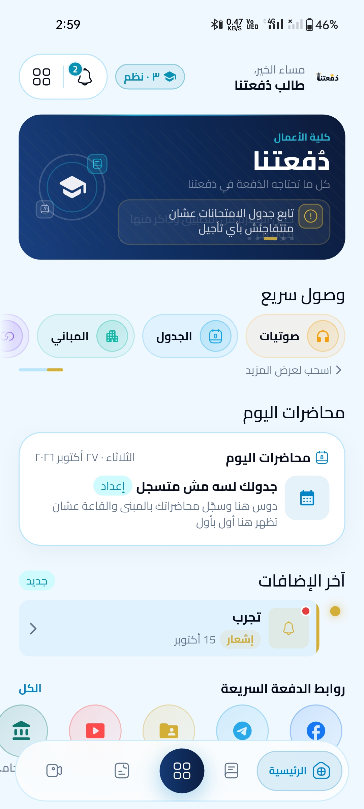
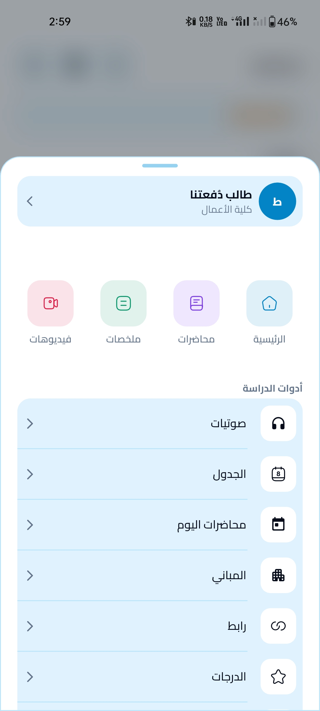
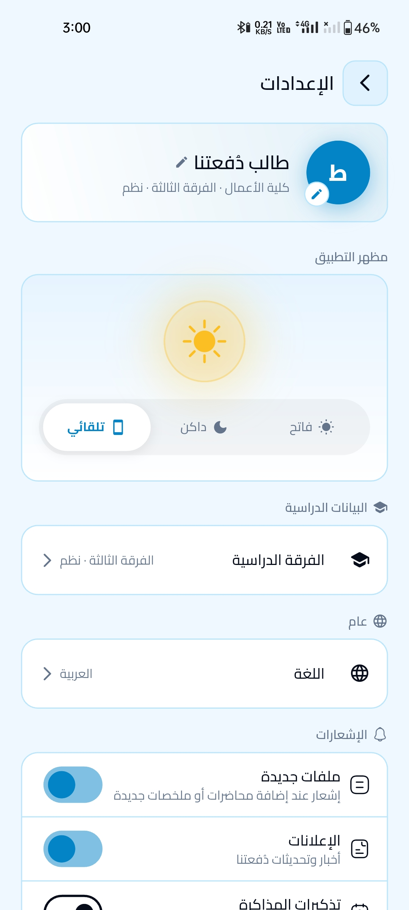
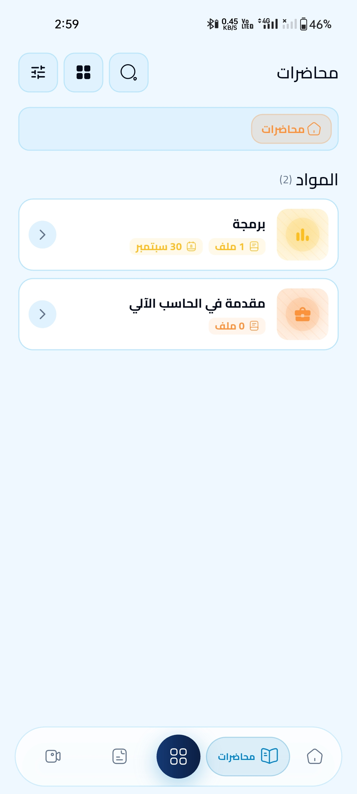
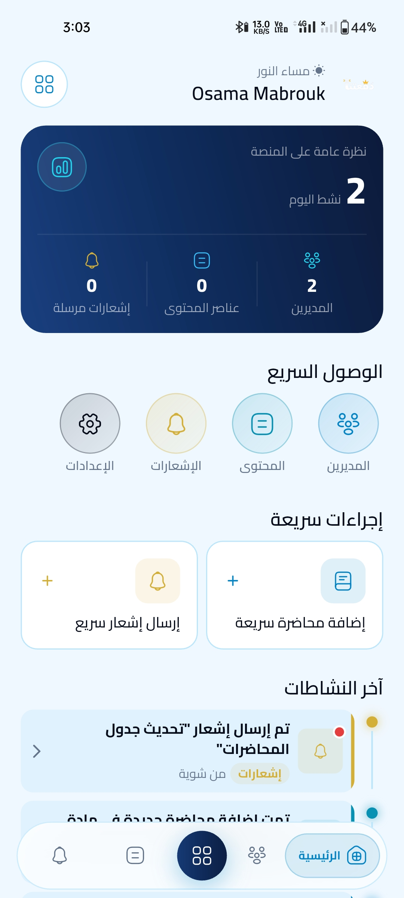
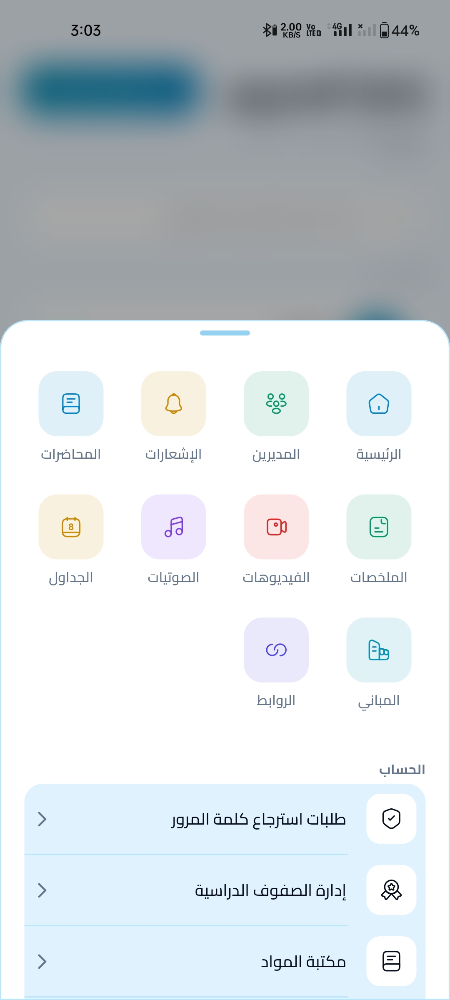

<div align="center">

# أسامة مبروك | O_M Portfolio

### مساحة رقمية لعرض الأعمال، الخبرات، والمشاريع البرمجية

<p>
  <strong>Flutter Developer</strong> ·
  <strong>Front-End Developer</strong> ·
  <strong>Back-End Developer</strong>
</p>

<p>
  <a href="https://osamamabrouk0.github.io/Portfolio/">
    
  </a>
  <a href="https://github.com/osamamabrouk0">
    
  </a>
</p>

</div>

---

## 👋 نبذة عن المشروع

مرحبًا بك في المستودع البرمجي لموقعي الشخصي **O_M Portfolio**؛ مساحة تجمع أعمالي ومهاراتي ومشاريعي في مكان واحد، وتعرض رحلتي في تطوير الويب وتطبيقات Flutter.

يهدف الموقع إلى تقديم تجربة واضحة لاستكشاف المشاريع، والتعرّف على التقنيات التي أستخدمها، والوصول إلى نسخ الويب والتطبيقات والأكواد المتاحة.

## 🖼️ معاينة من المشاريع

لقطات من مشروع **دُفعتنا** المعروض ضمن قسم المشاريع:

<p align="center">
  
  
  
</p>
<p align="center">
  
  
  
</p>

> الصور مرتبطة بمسارات نسبية داخل المستودع. ارفع مجلد `assets` مع `README.md` للحفاظ على ظهورها في GitHub.

## ✨ المميزات

- تصميم عربي يدعم اتجاه RTL.
- واجهة متجاوبة مع الهواتف والأجهزة اللوحية وشاشات الكمبيوتر.
- أقسام للتعريف الشخصي والمهارات والمشاريع.
- عرض منظم للمشاريع وروابط المواقع والتطبيقات والأكواد المتاحة.
- حركات وانتقالات بصرية خفيفة لتحسين تجربة الاستخدام.

## 🧰 التقنيات المستخدمة

| التقنية | الاستخدام |
|---|---|
| HTML5 | بناء هيكل الصفحة |
| CSS3 | التصميم والتخطيطات والتجاوب |
| JavaScript | التفاعلات وسلوك عناصر الواجهة |
| Google Fonts | الخطوط العربية واللاتينية |

المشروع صفحة ويب مستقلة ولا يحتاج إلى إطار عمل أو خطوات بناء (Build).

## 🚀 تشغيل المشروع محليًا

1. حمّل المستودع أو انسخه إلى جهازك.
2. افتح مجلد `pro-main`.
3. افتح ملف `index.html` في المتصفح.

يمكنك أيضًا فتح المجلد باستخدام Visual Studio Code وتشغيله عبر إضافة Live Server.

## 📁 هيكل المشروع

```text
pro-main/
├── assets/
│   └── dof3tna/
│       ├── student-1.jpg
│       ├── student-2.jpg
│       ├── student-3.jpg
│       ├── student-4.jpg
│       ├── admin-1.jpg
│       ├── admin-2.jpg
│       └── cv/
│           └── Osama-Mabrouk-CV.pdf
├── index.html
└── README.md
```

## 🛠️ التعديل والتخصيص

- **المحتوى:** عدّل النصوص والبيانات داخل `index.html`.
- **التصميم:** راجع قواعد CSS الموجودة داخل الملف.
- **التفاعلات:** راجع JavaScript الموجود داخل الملف.
- **الصور:** ضع الصور داخل `assets/dof3tna/` واستخدم أسماء الملفات ومساراتها الصحيحة.
- **المشاريع:** حدّث بيانات المشاريع وروابطها، ثم اختبر الروابط بعد التعديل.

## 🌐 الموقع المباشر

<p align="center">
  <a href="https://osamamabrouk0.github.io/Portfolio/">
    
  </a>
</p>

**رابط الموقع:** [O_M Portfolio](https://osamamabrouk0.github.io/Portfolio/)

## 👨‍💻 عن المطوّر

**أسامة مبروك | Osama Mabrouk**

مطور واجهات أمامية وخلفية، ومطور تطبيقات Flutter، مهتم ببناء منتجات رقمية عملية وتجارب استخدام واضحة باستخدام **HTML, CSS, JavaScript, PHP, MySQL, and Flutter**.

- **Portfolio:** [osamamabrouk0.github.io/Portfolio](https://osamamabrouk0.github.io/Portfolio/)
- **GitHub:** [github.com/osamamabrouk0](https://github.com/osamamabrouk0)

---

<div align="center">

**صُنع بعناية بواسطة أسامة مبروك**

_O_M Portfolio_

</div>
